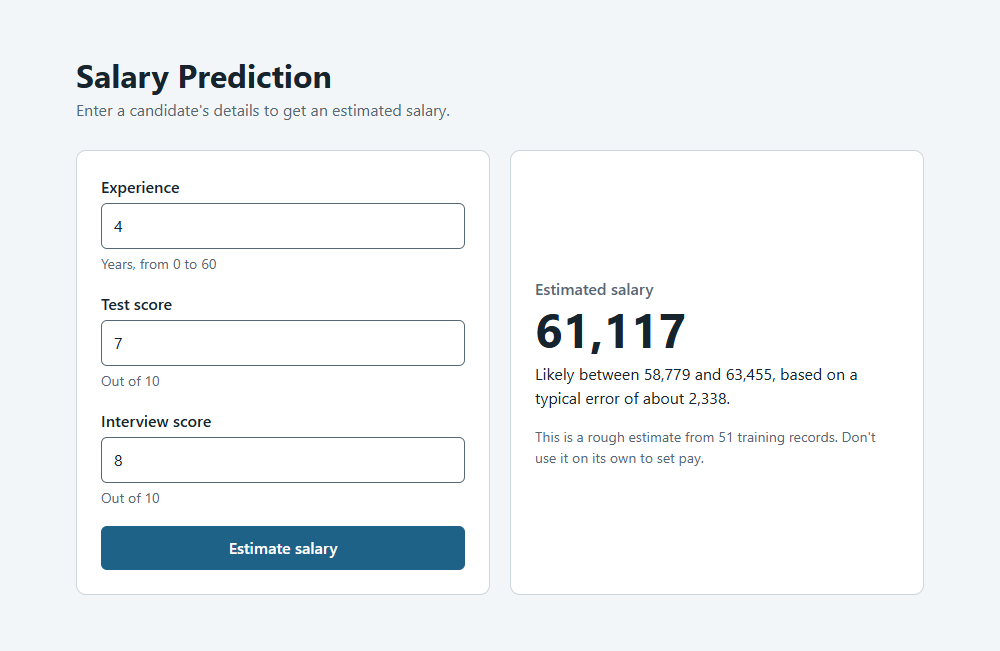
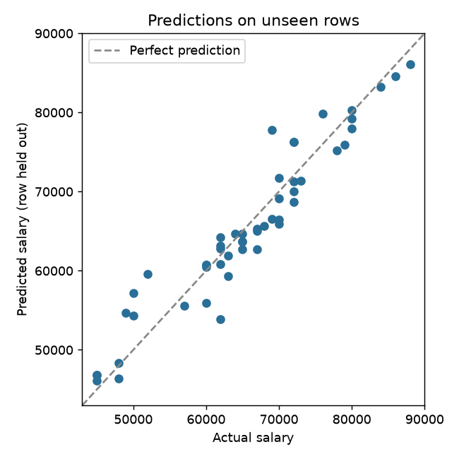

# Salary Prediction Model


A linear regression model that estimates a candidate's salary from years of experience, written test score and interview score. It handles the messy parts of the data, such as experience written as words and missing values, in one reusable scikit-learn pipeline.

## Web app

Enter a candidate's details in the browser and the model shows an estimated salary, a likely range, and a warning if the inputs are outside what it was trained on.



## Results

Each result below comes from `python -m salary_model.train`. The cross-validated rows use repeated 5-fold cross-validation, so every row is tested by a model that did not train on it.

| Evaluation | R² | Average error |
|---|---|---|
| Training data | 0.93 | 2,134 |
| Cross-validated | 0.89 | 2,338 |
| Cross-validated, duplicates removed | 0.87 | 2,459 |
| Baseline: always guess the average salary | below 0 | 8,592 |



| Input | Salary change per unit |
|---|---|
| Experience (per year) | +2,751 |
| Interview score (per point) | +2,507 |
| Test score (per point) | +1,021 |

## Getting started

Requires Python 3.12 or newer.

```bash
python -m venv .venv
source .venv/bin/activate      # Windows: .venv\Scripts\activate
pip install -r requirements.txt
```

Start the web app, then open <http://127.0.0.1:8000> in your browser:

```bash
python -m salary_model.api
```

Scores are out of 10. To stop the app, press `Ctrl+C` in the terminal. The API is documented at <http://127.0.0.1:8000/docs>, and it accepts `POST /predict` with `experience`, `test_score` and `interview_score` as JSON.

The trained model is included, so you only need the commands below to retrain it or predict for a whole CSV.

Train the model and write `models/salary_model.joblib` and `outputs/metrics.json`:

```bash
python -m salary_model.train
```

Predict salaries for a CSV with `experience`, `test_score` and `interview_score` columns:

```bash
python -m salary_model.predict --input data/hiring_test.csv --output outputs/output_file.csv
```

Run the tests:

```bash
python -m pytest
```

## How missing data is handled

- **Experience** can be a word (`four`) or a number (`4`). A blank value means zero years. In the training data, candidates with blank experience earn about the same on average as candidates with one year.
- **Test and interview scores** that are missing use the median learned from the training data. New files never change that value, so a candidate's prediction doesn't depend on who else is in the file.
- **Unreadable values** such as `banana` stop the run with an error that names the value.

## Project structure

```
├── data/            Training data and sample candidates
├── docs/images/     Screenshot and chart used in this README
├── models/          Saved model
├── notebooks/       Data exploration and evaluation
├── outputs/         Metrics and predictions
├── salary_model/    Cleaning rules, training, prediction and the web app
└── tests/           Automated tests
```

## Limitations

The dataset has only 51 rows, including 8 exact duplicates, and three inputs. Treat predictions as rough estimates for this data. They should not be used on their own to set anyone's pay.

The saved model only loads reliably with the library versions pinned in `requirements.txt`. Only load model files you trust, because loading one can run code.
